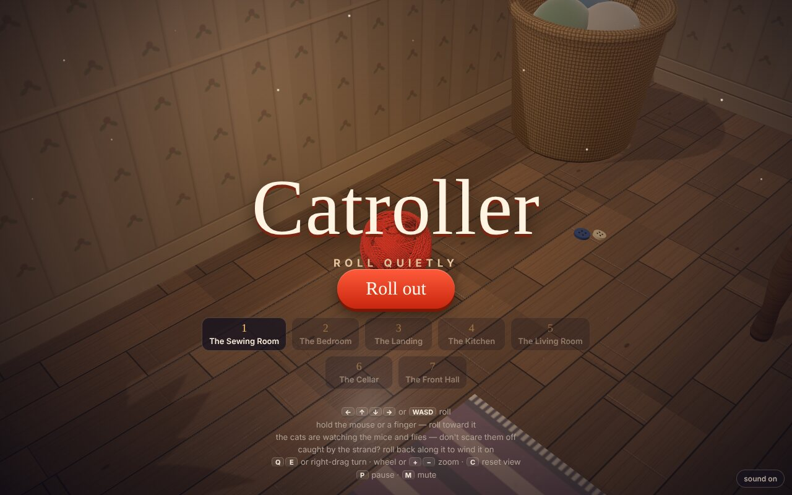
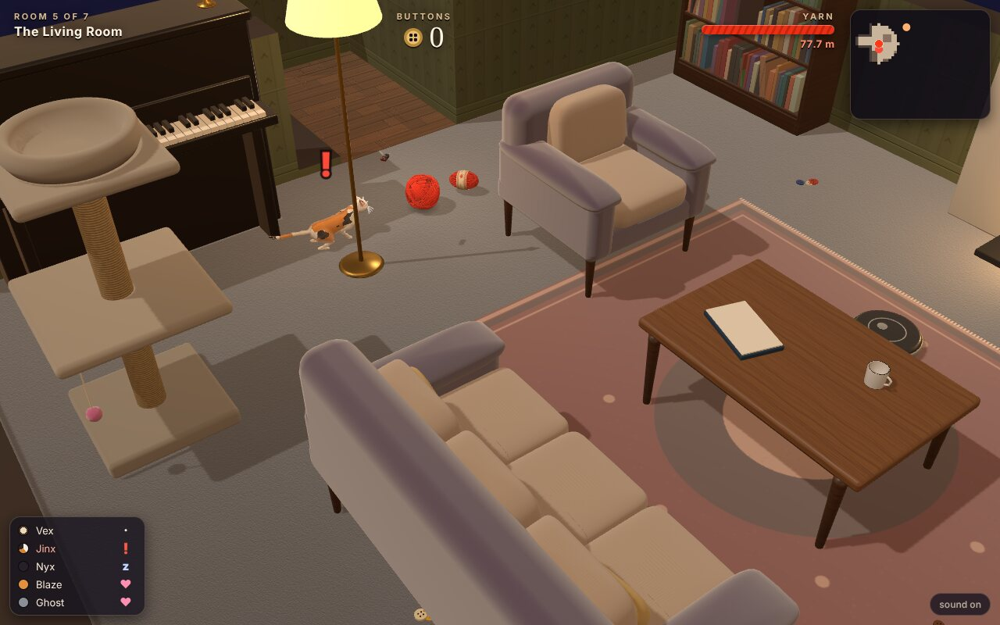
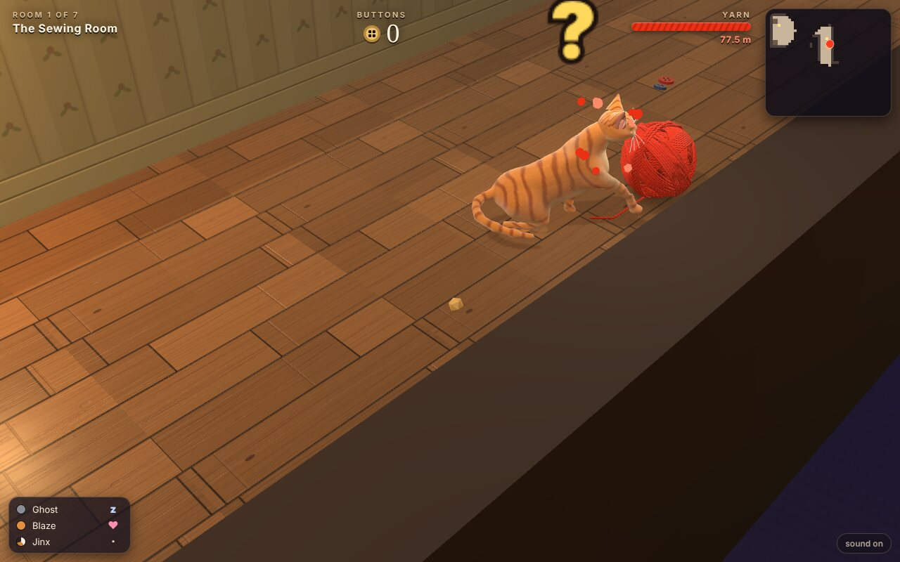
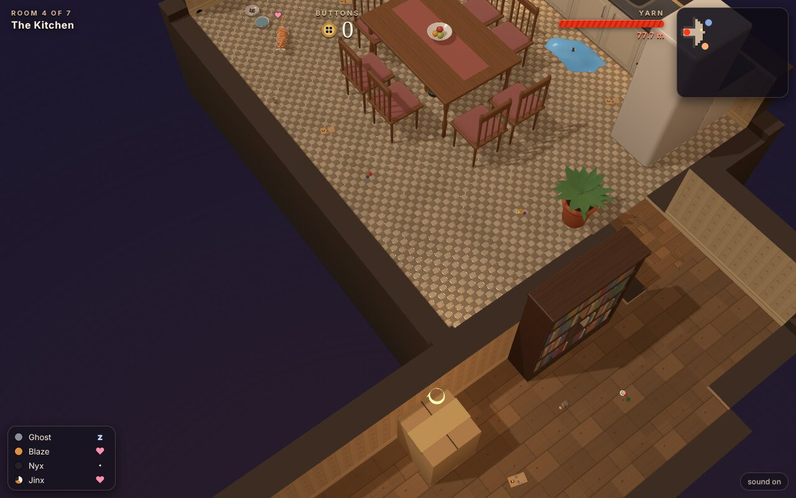

# Catroller

A sneaky rolling game. You're a ball of red yarn that has rolled out of the
knitting basket at night, and you have to get down through the house and out
of the cat flap. There are six cats in the house, and every one of them would
love to get its paws on you.

The cats have other things to look at, though. Mice run their rounds, flies
buzz about the lamps and beetles crawl along the skirting. A cat watching a
mouse doesn't see you roll by. The critters can't hurt you, but if you roll
too close, they bolt, and the cat that was watching one turns round to see
what scared it off.

The ball is the "Yarn" character asset, one strand wound into a ball, as
[Carol](https://github.com/h1ddenpr0cess20/carol) has it ported onto the
engine. Its winding, its tube and its ply texture are Carol's code, unchanged.
Everything else is built on
[Dungeon Roller](https://github.com/h1ddenpr0cess20/dungeon-roller): the
renderer, the ball physics, the tiled levels and the digger that lays them
out, the camera, the controls, and the way models are sculpted and baked.





## Run

```sh
git clone https://github.com/h1ddenpr0cess20/catroller
cd catroller
npm install
npm run dev               # → http://localhost:5173
```

There's no server and no keys: it's a static page. `npm run build` puts it in
`dist/`, which runs from any folder or path.

## Play

| | |
|---|---|
| <kbd>←</kbd><kbd>↑</kbd><kbd>↓</kbd><kbd>→</kbd> or <kbd>WASD</kbd> | Roll. |
| Hold the mouse or a finger | Roll toward the pointer. The further it is from the ball, the harder the push. |
| <kbd>Q</kbd> <kbd>E</kbd>, or drag with the right mouse button | Turn the view. Dragging up and down tilts it. |
| Mouse wheel, or <kbd>+</kbd> <kbd>−</kbd> | Zoom. |
| Two fingers | Pinch to zoom, twist to turn, drag up or down to tilt. |
| <kbd>C</kbd> | Put the view back. |
| <kbd>Enter</kbd> / <kbd>Space</kbd> | Start, and carry on after a room. |
| Gamepad | Left stick or d-pad rolls; right stick turns and tilts; shoulder buttons zoom; <kbd>A</kbd> starts and carries on, <kbd>Start</kbd> pauses. |
| <kbd>P</kbd> / <kbd>Esc</kbd> | Pause. |
| <kbd>M</kbd> | Sound on or off. |

### The cats

| | Coat | What it's like |
|---|---|---|
| **Blaze** | Ginger | The everyday cat: quick enough, and sharp-eyed enough. |
| **Nyx** | Black | The fastest. She sees a long way and hears well. |
| **Ghost** | Grey | Slow and a little dozy. He would rather watch a mouse than you. |
| **Jinx** | Calico | Small. She plays the longest with anything she catches. |
| **Vex** | Siamese | She misses nothing: she has the widest eyes, sees the furthest and hears the best. |
| **Brutus** | Tom | Big and slow, with a long reach. He keeps the front door. |

A cat sleeps, sits, or walks a beat. It sees what is in front of it, as far as
it can see and as long as nothing is in the way, and it takes a moment to be
sure. A **?** over its head means it has seen something. A **!** means it has
seen you, and then it comes after you. It goes back to what it was doing if
you get away from it for long enough.

- **Critters** keep the cats busy. A cat watching one won't see you, and the
  heart in the list down the side shows which cats are busy. If you scare the
  critter off, the cat comes looking.
- **Hiding.** Under a bed, a sofa, a dresser, or anything else too low for a
  cat to get under, no cat can see you.
- **Noise.** Rolling fast over wood, tiles or stone rattles, and it wakes a
  sleeping cat nearby. Carpets and rugs are quiet.

### The strand

The ball's loose end gets caught on things. When it does, the strand pays out
behind you along the floor wherever you roll. The ball gets smaller as it goes
and sits on the end of what it has let out, just as Carol's ball does.

- **A cat's paw.** A cat that catches you swats the ball away and keeps the
  end under its paw to play with it. Once the cat has had its fun, roll back
  along the strand and it winds back on. If you get away first, the strand
  snaps after 2.6 m.
- **Mousetraps** snap shut on the end and keep it. It snaps after 1.4 m.
- **Nails** standing up out of the cellar boards keep it for 1.6 m.
- **Stairs.** Going down a flight, the end catches on a nosing. A little
  unwinds behind you, and 0.6 m goes.

A strand that snaps leaves its piece on the floor, and the cats will play with
that too.

Yarn is also lost by falling off an edge into the dark (2 m), rolling into a
spill (2.5 m) and getting hoovered up by the robot vacuum (5 m). After each,
the ball goes back to the last safe floor it was on. A skein winds yarn back
on, though never more than a whole ball's worth. The ball carries its yarn from
room to room. With under 5 m left, it has come undone and the game is over.



### Buttons

Buttons are the score. They are scattered about the floors, and tins of them
hold a lot more. Clearing a room is worth ten buttons times its number. If no
cat saw you there, you get 25 more, and 15 more if none caught you. The
title screen keeps the best score, and lets you start from any room you have
reached.

### The rooms

| | | What's in it |
|---|---|---|
| The Sewing Room | 1 | Out of the knitting basket and past Ghost asleep on the rug, Blaze watching a mouse at its crumb, and Jinx going round the box room. |
| The Bedroom | 2 | A big bed to hide under, Vex asleep on the rug, Nyx going round the room, flies about the lamp, and a mousetrap by the wardrobe. Ghost sits in the dressing room, watching a mouse run its rounds. |
| The Landing | 3 | The bathroom, with spills across the tiles and Blaze watching a beetle. Then the landing, open to the stairwell along one side, and the long stairs down. |
| The Kitchen | 4 | A table and chairs to weave through, Nyx going round them, mousetraps where the mice run, and the pantry, with Jinx between two mice. |
| The Living Room | 5 | A sofa to hide under, the fire, the piano, Vex, who misses nothing, and the robot vacuum doing its rounds. Then the conservatory, with flies everywhere and Ghost on the prowl. |
| The Cellar | 6 | Down the steps into the dark. A store room of boxes and mice and traps, old boards with nails in them, a plank over the coal hole, and the laundry. |
| The Front Hall | 7 | A long runner, coats and boots, another vacuum, Brutus by the door, and the cat flap. |



The map in the corner shows what you have seen so far, and any cat or critter
near you.

## How it's made

| | |
|---|---|
| `src/vendor/gfx/` | Alan's renderer, as Dungeon Roller and Carol have it. It uses WebGPU where the browser has it and WebGL 2 where it doesn't (`?renderer=webgl` pins it). |
| `src/yarn/winding.js`, `model.js`, `path.js` | The Yarn character, from Carol: the winding, the tube with its ply texture, and the strand's path. The only change is that `model.js` exports its tube builder for the ball to use. |
| `src/yarn/ball.js` | Carol's ball rolled by the game's physics instead of along Carol's route. It rolls free until something catches the end, then lays the strand out along the floor and poses the ball from it. It also winds the strand back on, snaps it, and cuts off the piece that is left behind. |
| `src/physics.js` | The ball physics, as Dungeon Roller has it. |
| `src/house.js`, `src/dig.js` | Tiles with four corner heights, as Dungeon Roller's dungeons have, turned into rooms: floors of wood, carpet, tile, boards and stone, papered walls, stairs, spills, and the furniture. The digger lays a level out a piece at a time. |
| `src/furniture.js`, `src/scenery.js` | The furniture: solid boxes for the physics and the cats, and everything drawn over them, from cushions and turned legs to books, piano keys and a fire in the grate. Also the painted textures. |
| `src/shapes.js` | The shapes the furniture and props are made of: rounded boxes, cushions, lathe turnings, swept baths and basins, tubes, leaves and rows of books. |
| `src/levels.js` | The seven rooms. |
| `src/models/` | The cats and the mouse, sculpted in code from signed distance fields, rigged and baked in workers. The cats are built bone by bone like a real cat, so they can sit on their haunches, curl up in a loaf, walk and gallop, and they blend from one pose to the next. See `models.html` for a turntable. |
| `src/nav.js` | How the cats find their way round the furniture. |
| `src/cats.js` | What each cat sees and hears, and what it does about it. |
| `src/critters.js` | Mice, flies and beetles: their rounds, and where they bolt to. |
| `src/actors.js` | Mousetraps, nails, vacuums, buttons, tins, skeins, and the bits of strand left lying about. |
| `src/sneak.js` | One level with nothing drawn: the rules for what catches the strand, what costs yarn, and what can be picked up. The game draws it; the tests drive it. |
| `src/audio.js`, `src/score.js` | Every sound and the music, synthesised with Web Audio. The music tenses up when a cat is onto you. |

| Script | |
|---|---|
| `npm run dev` | Vite dev server |
| `npm run build` | Bundles to `dist/` |
| `npm run preview` | `build`, then serves `dist/` |
| `npm test` | `node:test`. Covers the yarn ball, the physics, the house and the digger, the cats' eyes and ears, and the models. An autopilot plans its own way through every room. It has to get from the start to the doorway out without losing the ball once. |
| `npm run lint` | ESLint |
| `node scripts/map.js 3` | Prints a level as text, for laying one out (`--heights` for the floor heights). |
| `node scripts/bake.js` | Bakes the models the way the game does, and says how big they came out. |

`yarn.html` shows the ball on its own: on Carol's route, caught and rolled out
(`?snag=1`), or rolling free (`?free=1`).

The renderer is three.js-shaped but isn't three.js; see
`src/vendor/gfx/LICENSE` for what it ports from it.
